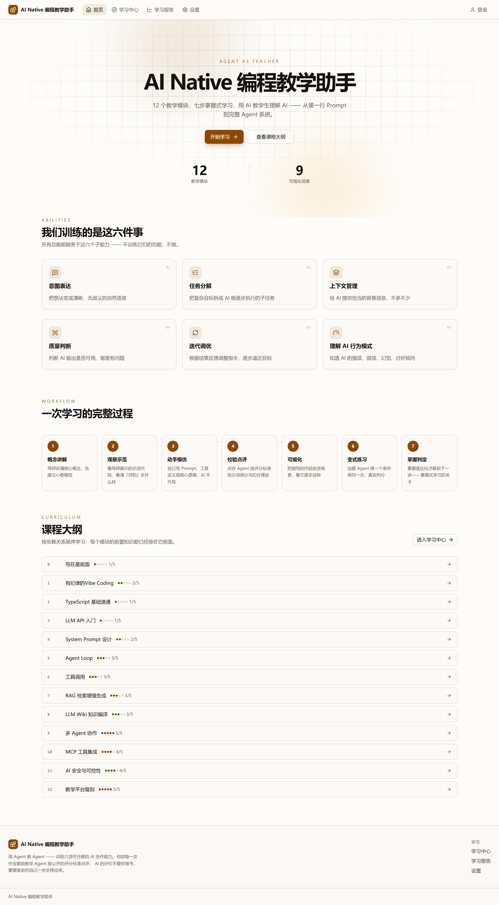
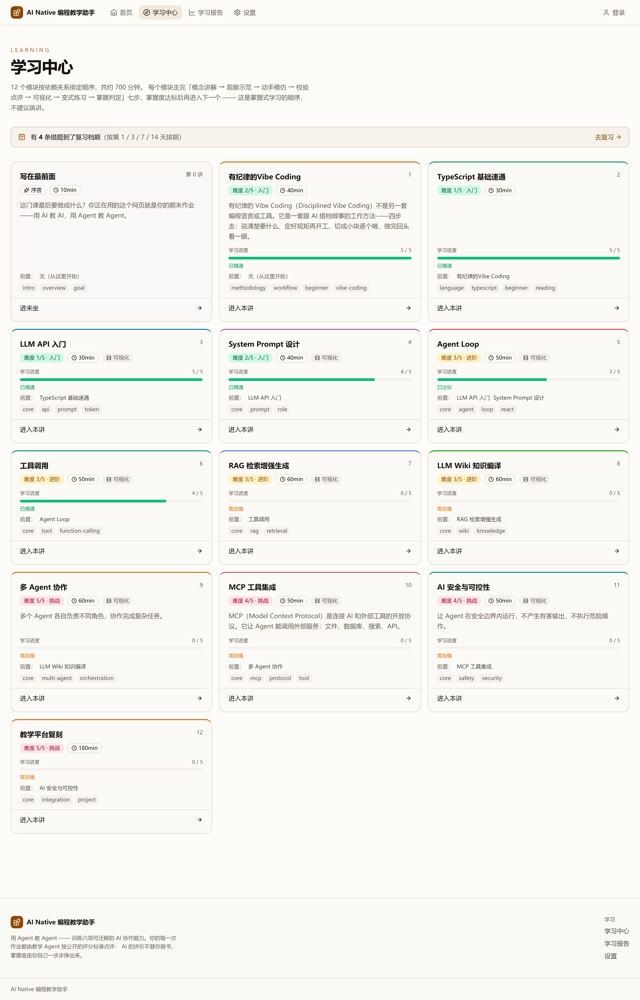
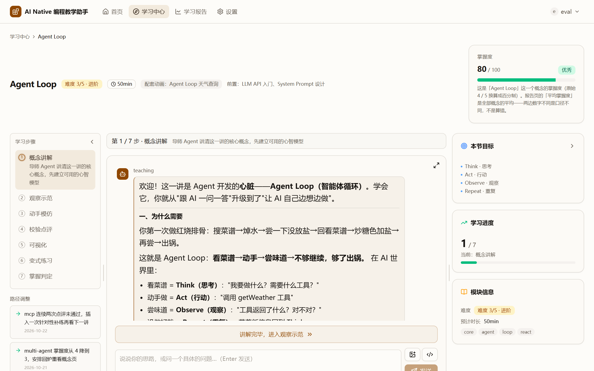
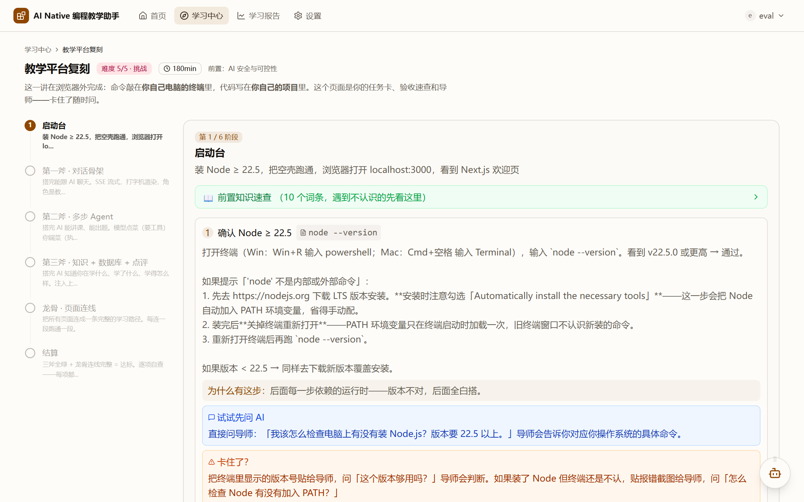
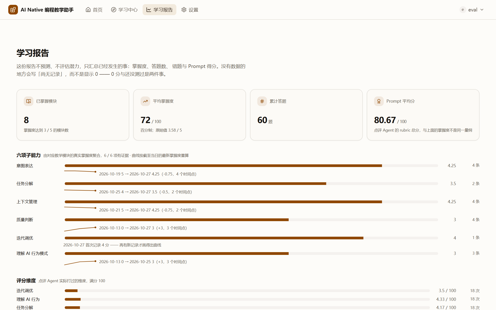

# AI Native 编程教学助手

## 作品介绍

| 项 | 内容 |
| --- | --- |
| 作品名称 | AI Native 编程教学助手 |
| 参赛赛事 | 传智杯「AI WEB 网页开发挑战赛」C 组 |
| 作者 / 院校 | 江家俊 · 广东交通职业技术学院 |
| 线上地址 | http://8.149.130.30 |
| 代码仓库 | 私有仓库（提交截止前开放给评审，或按组委会要求提供压缩包） |
| 作品形态 | 以 Web 前端为主要呈现形态，后端仅作为 AI 能力接入层 |

---

## 一、项目详情与使用方式

### 1.1 这是什么

**AI Native 编程教学助手是一个"用 Agent 教 Agent"的学习平台**：它不直接教学生写某一段代码，而是训练学生在与 AI 协作中可迁移的六项能力——意图表达、任务分解、上下文管理、质量判断、迭代调优、理解 AI 行为模式。

平台的学习大纲共 **12 讲**：11 讲概念课（TypeScript 基础、LLM API、System Prompt、Agent Loop、工具调用、RAG、LLM Wiki、多 Agent、MCP、AI 安全、有纪律的 Vibe Coding），加 1 个贯穿式实践项目「教学平台复刻」（这一讲内部再展开为 6 个阶段的阶段手册，不另占讲次），另设第 0 讲序言页；主线约 **700 分钟**，含 9 个可视化场景——学生最后要复刻的，正是他此刻正在使用的这个网站。

*图 1　首页：12 讲 + 第 0 讲序言的课程大纲、12 个教学模块、9 个可视化场景*

### 1.2 每一讲怎么教：七步掌握式学习

每个模块固定走七步，缺一步都不算学完：

1. **概念讲解**——导师 Agent 讲清心智模型，先建立"为什么"；
2. **观察示范**——给出可运行的示范代码，让学生看清"对的"长什么样；
3. **动手模仿**——学生自己写 Prompt、工具定义或核心逻辑，AI 不代写；
4. **校验点评**——点评 Agent 按该模块的评分标准逐维度打分，指出扣分点并给建议；
5. **可视化**——把刚写的东西放进 9 个可视化场景里，看它逐步运转；
6. **变式练习**——出题 Agent 换一个条件再问一次，真实判分；
7. **掌握判定**——掌握度达标（≥3/5）才解锁下一讲。

讲解、示范、模仿三步在界面上**分屏隔离**：讲解只讲概念，示范只给代码并设确认门控，模仿才开放对话，避免上一环节的内容串到下一环节。学生的每一次提问都携带当前阶段与模块上下文，导师不会答成"泛泛的编程问答"。

*图 2　学习中心：12 讲按依赖关系排序，「第 0 讲」序言页说明这门课最终要做成什么*

### 1.3 使用方式（三步上手）

**第一步：注册并登录。** 打开线上地址，未登录会被引导到登录页；注册后进入学习中心，首页会给出"从哪一讲开始"的路径建议（按前置知识排序）。

**第二步：学一讲。** 点任一模块进入七步流程。左栏是步骤导航与学习路径调整建议，中间是导师对话与代码区，右栏是本节目标、学习进度与模块信息。讲解开场即自动开讲，学生可随时追问；到示范步骤需确认后才进入模仿。

**第三步：看结果。** 完成点评与练习后，学习报告页会给出掌握度、六项能力成长曲线、评分维度、错题本、Prompt 历史与复习档期。

*图 3　讲解步骤：导师按讲稿开讲，右栏同步显示教学子能力（Think / Act / Observe / Repeat）*

**评委/访客快速体验路径**：首页右上角的「评委演示」按钮直达 System Prompt 讲解页，无需自己挑模块。平台也预置了演示学习数据，报告页可直接看到真实的掌握度、错题与成长曲线。

**实践项目怎么用**：进入「教学平台复刻」后是六个阶段（启动台 → 第一斧·对话骨架 → 第二斧·多步 Agent → 第三斧·知识库+数据库+点评 → 龙骨·页面连线 → 结算）。命令在学生自己的终端里跑，代码写在学生自己的项目里；页面只负责任务卡、验收清单与导师答疑。每阶段都有「验收脚本」「Agent 自查」两个自检入口，最后阶段用「交付与检验单」把关键文件交给点评 Agent，按知识库里现读的八条验收清单逐条找证据打分。

*图 4　复刻工作区：六阶段任务卡，每阶段含命令清单与前置知识速查*

---

## 二、项目亮点

**1. 真正的教学闭环，不是聊天机器人。** 讲解、示范、模仿、点评、可视化、变式练习、掌握判定七步都有落库产物：点评写入 `validation_results`、`prompt_history`、`errors`，掌握度与六项能力曲线由真实评分聚合。界面上的分数全部来自数据库真实行，没有一处是写死的演示数据。

**2. 用 Agent 教 Agent，四个 Agent 分工明确。** 导师（teaching）、点评（reviewer）、出题（examiner）、答疑（assistant）各有独立的提示词、技能白名单与输出结构；所有 Agent 输出都走 JSON + Zod 校验，失败时把字段级错误回喂重试，而不是把整个讨论过程塞进一个 Prompt。

**3. 知识库是运行时现读的，不是预生成文案。** 概念页、讲稿、评分细则都放在 `llm-wiki/`，页面按 schema 现读；讲稿缓存只存 11 讲的讲解稿，改动与入库可追溯。混合检索（关键词 + 向量 + RRF 融合）为导师提供引用来源，回答可点开原文。

**4. 9 个可视化场景把抽象机制"放慢"给学生看。** Token 生成、Prompt 分层、Agent 循环、工具调用、检索增强、上下文压缩、多 Agent 协作、能力边界、安全闸门——每一步都可播放、暂停、步进、倍速，场景断言 17 例由测试守护。

**5. 掌握式学习，有路径也有刹车。** 掌握度不达标不跳讲；连续失败、错题积压、掌握度下降会自动生成路径调整建议；错题按第 1/3/7/14 天排复习档期，学习页与报告页都能直接进入复习。

**6. 工程化程度可验证。** 类型检查 0 error、Lint 0 error、单元/集成测试 134 例、CI 28 组、浏览器端到端验收、报告页明细断言、掌握度水合断言、生产构建成功——四级验证（类型 → 测试 → 构建 → 浏览器）缺一不可，CI 与本地用同一套脚本。

**7. 面向真实课堂的安全设计。** 输入过滤拦截提示词注入与越权角色扮演，输出对密钥与内部路径打码，11 个进程内限流桶覆盖注册/登录/对话/点评/判分，思维链做内部术语过滤（不是禁词，而是给替换口径），工具白名单三层收敛（`tools` + `noExtensions` + `customTools`）。

---

## 三、AI 测试技术落地情况概述

项目的测试体系不只为"代码能跑"，还专门为"AI 行为可控"设计了验证手段。

### 1. 常规工程测试（每次提交必跑）

| 层级 | 手段 | 当前结果 |
| --- | --- | --- |
| 类型 / 静态检查 | `tsc --noEmit`、ESLint（含 Next 规则） | 0 error |
| 单元 / 集成 | Vitest，18 个测试文件 | 134 例全绿 |
| 脚本级回归 | `node scripts/run-tests.mjs --ci`，28 组（纯函数 + DB + 路由） | 28/28 |
| 生产构建 | `next build` | 成功 |
| 浏览器端到端 | 真实浏览器跑 A0–A8 教学流程断言 | PASS |
| 页面明细 | 报告页 8 项断言，文本取自数据库当次真行 | 8/8 |
| 状态水合 | 掌握度卡 4 项断言（store hydrate 是否真的生效） | 4/4 |
| 跨浏览器 | 三引擎断言脚本，本机实测 Edge | 11/11 |

### 2. 专门针对 LLM 的测试

- **真模型组**：3 组测试真实调用模型，验证点评返回结构、判分合理性与兜底行为；模型不可用时必须标 `usedFallback` 且不计入掌握度，测试断言这一点。
- **思维链泄漏双轮核验**：`verify-thinking-leak.ts` 用两轮真实调用（一轮完整、一轮交叉）覆盖四讲，检查思维链与 SSE 流里是否出现内部术语，要求 `internalHits=0`、`errors=0`；服务端另有 `thinking-filter.ts` 在真实流量上兜底。
- **检索质量评测**：三路召回对比（关键词 / 纯向量 / 混合）22 条查询，recall@3 分别为 68.2% / 95.5% / 90.9%，融合倒挂问题记录在案，作为后续优化依据。
- **点评口径定制测试**：复刻模块的点评题面从 wiki 现读验收清单，测试确保维度跟随清单、无证据的条目不编分。
- **内容一致性核验**：讲稿、概念页、测验的可数承诺词人工比对（如「五道闸门」「场景 A/B/C」），防止修改讲稿后术语失配。

### 3. 覆盖率与门禁

当前行覆盖率 25.36%，行/分支/函数/语句四级阈值（24/19/19/23）写进配置；删除测试或漏断言会直接让 CI 变红。

### 4. 安全与限流的测试落点

限流先于请求体解析（避免大 body 绕过）、未登录访问受保护端点必须 401、跨用户读取必须 403、点评兜底不得写 `errors`（把模型的失败记成学生的失败）——这些都有对应断言。

---

## 四、关键技术

| 层 | 技术选型与说明 |
| --- | --- |
| 前端框架 | Next.js 16（App Router）+ React 19，页面与接口同仓；首屏静态内容 0ms 渲染，异步块用 Suspense 骨架占位 |
| 样式与动效 | Tailwind CSS v4 + `motion`（`motion/react`），入场动画只动位移不动透明度，尊重系统「减少动态效果」 |
| 状态管理 | Zustand 5，7 个 store；`StudentBootstrap` 每页 hydrate 学情，掌握度卡读 store 而非接口 |
| 教学界面 | 三步分屏工作区（讲解/示范/模仿）、模块会话隔离、阶段位置持久化；代码编辑器为受控 textarea（刻意不引重型编辑器） |
| 流式对话 | SSE 10 类事件；Token 按同一 tick 合并为一次 `setState`（`setTimeout(0)`），解决 30–80 次/秒重渲染卡死；引用检索与会话创建并行 |
| Agent 编排 | 4 个 Agent（teaching / reviewer / examiner / assistant）× 4 个编排循环；输出 JSON + Zod 校验；`extractJson` 先无损提取再判定 |
| 技能体系 | 20 个 Skill（含 16 个 `validate-*` 点评技能与 4 个任务类型兜底），服务端按 `moduleId → 任务类型 → validate-code` 三级落线 |
| 知识库 | `llm-wiki/` Markdown 知识库，8 个声明目录、83 个页面；页面类型由 `SCHEMA.md` 现读决定，不写死在代码里；MCP 知识库服务只暴露 1 个 `search_wiki` |
| 混合检索 | 关键词召回 + 向量召回（qwen3.7-text-embedding，1024 维，375 块）+ RRF 融合；向量路失败自动降级关键词并打 `usedFallback` |
| 数据层 | SQLite（`dev.db`，17 张业务表，6 个迁移）↔ PostgreSQL 双形态，驱动名只允许出现在 `sqlite.ts`；PG/pgvector 为预留形态，未上线 |
| 讲解缓存 | `lecture_cache` 只存 11 讲的讲解稿；改稿唯一入口是手写直写脚本（零模型调用），并有 7 例结构守卫 |
| 鉴权与安全 | scrypt 密码哈希 + JWT（HS256，7 天）；输入过滤、输出打码、11 个限流桶、思维链术语过滤 |
| 可观测 | `agent_traces` 记录每次调用（当前库内 620 条真实流量），点评、错题、Prompt 历史分别落表，报告页直接消费 |
| 测试 | Vitest + 自建脚本运行器 + 真实浏览器验收脚本 + Playwright（截图/打印）+ 覆盖率门禁 |
| 部署 | 阿里云 ECS（1C1G）+ systemd + nginx 反代（SSE 关缓冲）；本机构建、只传 `.next`，避免小机器构建触发 swap 风暴 |

---

## 五、项目相关的图片

| 图 | 内容 | 文件 |
| --- | --- | --- |
| 图 1 | 首页：模块数 / 主线时长 / 场景数三项实时统计（数据来自知识库现算） | `assets/home.png` |
| 图 2 | 学习中心：12 讲卡片 + 第 0 讲序言卡片 + 今日该复习提示 | `assets/learn.png` |
| 图 3 | 讲解步骤：导师讲稿流式输出、右栏教学子能力与学习进度 | `assets/explain.png` |
| 图 4 | 教学平台复刻工作区：六阶段任务卡与命令清单 | `assets/replica.png` |
| 图 5 | 学习报告：掌握度、六项能力成长曲线、评分维度（数据取自真实演示账号） | `assets/report.png` |

*图 5　学习报告：六项能力曲线按证据日重算，没有证据的地方写「暂无」而不是画 0*

---

## 六、项目之前是否发表过或获奖

**未发表、未获奖。** 本项目是为本届赛事独立开发的作品，此前没有在期刊、会议或公开平台发表，也没有参加过其他比赛、未获得任何奖项或商业资助。

需要如实说明的两点：

1. 代码托管在私有仓库，未对外公开发布；提交截止前会按组委会要求向评审开放（或提供完整压缩包）。
2. 线上环境为个人阿里云 ECS，域名与 HTTPS 尚未配置，评审期以 IP 访问为准；若需长时间演示，会提前确认端口可达。

---

## 七、是否在其他项目基础上优化

**不是。本项目从零自建，没有基于任何其他参赛作品或开源项目二次开发。**

需要区分两类"沿用"，避免误解：

**1. 使用了开源框架与库（正常依赖，不构成"基于其他项目优化"）**
Next.js、React、Tailwind CSS、Zustand、Zod、motion、Vitest、Playwright 等均为公开开源依赖，按各自许可证使用；业务代码、提示词、知识库内容、教学流程、可视化场景全部为本项目原创。

**2. 项目自身的演进（同一作品的迭代，不是"别人的项目"）**

- 早期曾实现"教师端"与"学生模拟器"两套模块，后因教学变量过多、演示时难以讲清，**整体下线**（历史提交保留，未删除记录）；这属于作者对产品范围的主动收缩，不是失败回滚。
- 早期有一个页面级"内容审计"入口，随架构调整一并移除，改为人工比对 + 测试守卫。
- 讲解稿从 12 讲收敛为 11 讲（复刻模块改为任务卡 + 概念页手册承载教学），缓存随之调整。
- 检索的 embedding 模型因免费额度耗尽更换过一次，更换后做了全量索引重建与三路召回对比。

上述演进都留有提交记录与设计文档，可在评审时逐条追溯。
